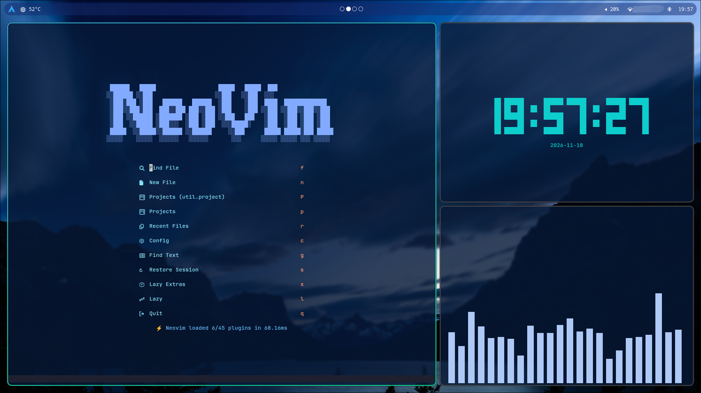

# hyprland-dots

This is my hyprland dotfiles

## Preview

### Waybar

### Installation

Idk how to make installer so download the configs and edit if there is full path with username, etc.

For fish download fastfetch config and [tide](https://github.com/IlanCosman/tide) and make sure that fastfetch is in autostart file.
